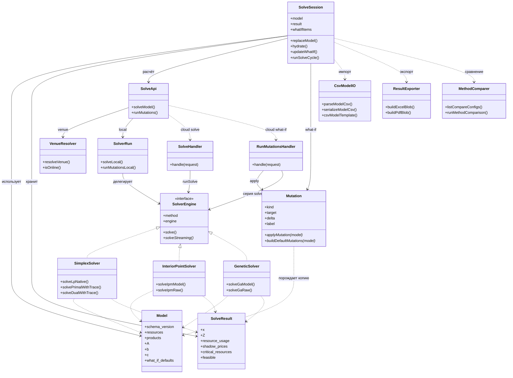

# UML — Classes

Диаграмма классов (логические сущности модуля планирования) и таблицы для пояснительной записки.

Рисунок в пояснительной: **2.5**.  
Классы **1–16** — ядро отчёта (вспомогательные методы и UI-kit опущены).

---

## Диаграмма

`*` у метода — опциональный / пакетная операция рядом с сущностью (в коде — функции модуля).

---

## Таблица 2.1 — Классы клиентской части

| Класс              | Назначение                                                                 | Методы                  | Назначение методов                                                              |
| ------------------ | -------------------------------------------------------------------------- | ----------------------- | ------------------------------------------------------------------------------- |
| **SolveSession**   | Сессия редактора задачи: модель, результат, what-if, запуск цикла расчёта. | `replaceModel()`        | Подставить новую модель; при смене содержимого сбросить производные результаты. |
|                    |                                                                            | `hydrate()`             | Восстановить состояние сессии из сохранённого узла / черновика.                 |
|                    |                                                                            | `updateWhatIf()`        | Обновить проценты вариаций чувствительности в модели.                           |
|                    |                                                                            | `runSolveCycle()`       | Выполнить solve и при необходимости пакет what-if через транспорт.              |
| **SolveApi**       | Клиентский транспорт расчёта: локальный солвер или Edge.                   | `solveModel()`          | Решить задачу (с учётом venue / cloud).                                         |
|                    |                                                                            | `runMutations()`        | Прогнать набор мутаций (what-if) тем же транспортом.                            |
| **VenueResolver**  | Выбор площадки вычислений (клиент / облако).                               | `resolveVenue()`        | Вернуть `local` или `cloud` по флагу и сети.                                    |
|                    |                                                                            | `isOnline()`            | Проверить доступность сети.                                                     |
| **CsvModelIO**     | Импорт и выгрузка модели в CSV (табличный вид).                            | `parseModelCsv()`       | Разобрать CSV в `Model`.                                                        |
|                    |                                                                            | `serializeModelCsv()`   | Сериализовать `Model` в CSV.                                                    |
|                    |                                                                            | `csvModelTemplate()`    | Выдать пустой шаблон CSV.                                                       |
| **ResultExporter** | Экспорт плана и связанных таблиц в файлы.                                  | `buildExcelBlob()`      | Сформировать Excel (план, ресурсы, what-if).                                    |
|                    |                                                                            | `buildPdfBlob()`        | Сформировать PDF-отчёт.                                                         |
| **MethodComparer** | Сравнение конфигураций методов решения.                                    | `listCompareConfigs()`  | Список доступных пар method×engine.                                             |
|                    |                                                                            | `runMethodComparison()` | Запустить сравнение и собрать метрики (Z, gap, время, …).                       |

---

## Таблица 2.2 — Классы домена и вычислительного ядра (клиент и сервер)

| Класс                   | Назначение                                                 | Методы                    | Назначение методов                                                                           |
| ----------------------- | ---------------------------------------------------------- | ------------------------- | -------------------------------------------------------------------------------------------- |
| **Model**               | Предметная модель задачи распределения ресурсов.           | —                         | DTO: ресурсы, продукция, матрица \(A\), запасы \(b\), цены \(c\), единицы, what-if defaults. |
| **SolveResult**         | Результат одного решения.                                  | —                         | DTO: план \(x\), \(Z\), загрузка/остатки ресурсов, теневые цены, допустимость.               |
| **Mutation**            | Описание вариации параметров для анализа чувствительности. | `applyMutation()`         | Применить мутацию к копии модели.                                                            |
|                         |                                                            | `buildDefaultMutations()` | Построить набор мутаций из `what_if_defaults`.                                               |
| **SolverRun**           | Локальный фасад запуска солвера и what-if.                 | `solveLocal()`            | Решить модель выбранным методом/движком на клиенте.                                          |
|                         |                                                            | `runMutationsLocal()`     | Локально прогнать список мутаций.                                                            |
| **SolverEngine**        | Контракт движка одного метода решения.                     | `solve()`                 | Получить `SolveResult` (и опционально trace).                                                |
|                         |                                                            | `solveStreaming()`        | Пошаговая выдача кадров трассировки (если поддерживается).                                   |
| **SimplexSolver**       | Решение ЛП симплекс-методом (native).                      | `solveLpNative()`         | Полное решение модели симплексом.                                                            |
|                         |                                                            | `solvePrimalWithTrace()`  | Прямая задача с кадрами симплекс-таблиц.                                                     |
|                         |                                                            | `solveDualWithTrace()`    | Двойственная задача с трассировкой.                                                          |
| **InteriorPointSolver** | Метод внутренней точки.                                    | `solveIpmModel()`         | Решение модели IPM → `SolveResult`.                                                          |
|                         |                                                            | `solveIpmRaw()`           | «Сырой» исход IPM (успех / причина отказа).                                                  |
| **GeneticSolver**       | Генетический (эволюционный) алгоритм.                      | `solveGaModel()`          | Решение модели ГА → `SolveResult`.                                                           |
|                         |                                                            | `solveGaRaw()`            | Исход ГА с популяцией / поколениями.                                                         |

---

## Таблица 2.3 — Классы серверных обработчиков (Edge)

| Класс                   | Назначение                                          | Методы            | Назначение методов                                                       |
| ----------------------- | --------------------------------------------------- | ----------------- | ------------------------------------------------------------------------ |
| **SolveHandler**        | Edge Function `solve`: HTTP-вход облачного расчёта. | `handle(request)` | Принять модель и параметры, вызвать общий `runSolve`, вернуть JSON.      |
| **RunMutationsHandler** | Edge Function `run_mutations`: облачный what-if.    | `handle(request)` | Принять модель и мутации, ограничить \(K\), серия решений, вернуть JSON. |

На сервере те же **SolverEngine** / **SimplexSolver** / **InteriorPointSolver** / **GeneticSolver** (зеркало `_shared/solver`); в таблицах ядра они не дублируются.

---

## Соответствие коду

| Класс UML                    | Где в репозитории                                      |
| ---------------------------- | ------------------------------------------------------ |
| Model, SolveResult, Mutation | `src/lib/domain/types.ts`, `domain/mutations.ts`       |
| SolveSession                 | `src/lib/components/model/solve-session.svelte.ts`     |
| SolveApi                     | `src/lib/api/solve.ts`                                 |
| VenueResolver                | `src/lib/solver/venue.ts`                              |
| SolverRun                    | `src/lib/solver/run.ts`, `solver/mutations.ts`         |
| SolverEngine                 | `src/lib/solver/contract.ts` + `registry.ts`           |
| SimplexSolver                | `src/lib/solver/methods/lp/simplex.ts`, `lp/native.ts` |
| InteriorPointSolver          | `src/lib/solver/methods/ipm/native.ts`                 |
| GeneticSolver                | `src/lib/solver/methods/ga/native.ts`                  |
| SolveHandler                 | `supabase/functions/solve/index.ts`                    |
| RunMutationsHandler          | `supabase/functions/run_mutations/index.ts`            |
| CsvModelIO                   | `src/lib/io/csv-model.ts`                              |
| ResultExporter               | `src/lib/io/export-result.ts`                          |
| MethodComparer               | `src/lib/solver/compare.ts`                            |
