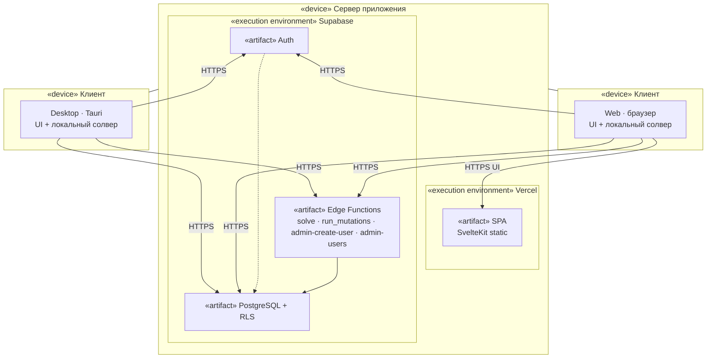
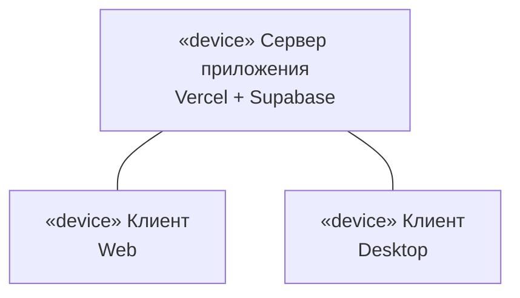

# UML — Deployment

Диаграмма развёртывания клиент-серверного приложения **«Планировщик распределения ресурсов»** (Resource Allocation Planner).

Один файл = один тип UML. Рядом: [`use-case.md`](use-case.md), [`sequence.md`](sequence.md), [`classes.md`](classes.md).

---

## Диаграмма

Композиция в духе учебной схемы: сервер сверху, клиенты снизу.

Упрощённый вид (максимально близко к классическому примеру «один сервер — два клиента»):

---

## Описание

### Назначение

Показать, **на каких узлах** размещаются артефакты системы и **как клиенты связаны** с серверной частью. Предметная логика (LP-модель, what-if) сюда не входит — только размещение и каналы связи.

### Узлы

| Узел                  | Стереотип               | Что размещено                                                      |
| --------------------- | ----------------------- | ------------------------------------------------------------------ |
| **Сервер приложения** | `device`                | Логический серверный узел: хостинг UI и backend.                   |
| **Vercel**            | `execution environment` | Production SPA (`pnpm build` → `build/`, SPA-rewrites).            |
| **Supabase**          | `execution environment` | Auth; PostgreSQL + RLS; Edge Functions; `pg_cron` (purge корзины). |
| **Клиент (Web)**      | `device`                | Браузер пользователя: UI + **локальный** солвер по умолчанию.      |
| **Клиент (Desktop)**  | `device`                | Tauri WebView: тот же UI в установщике + локальный солвер.         |

### Связи

| От → к                               | Смысл                                                                                    |
| ------------------------------------ | ---------------------------------------------------------------------------------------- |
| Клиент Web → Vercel                  | HTTPS: загрузка статики UI                                                               |
| Клиент Web / Desktop → Supabase Auth | HTTPS: вход, JWT (публичная регистрация отключена)                                       |
| Клиент → PostgreSQL (Supabase API)   | HTTPS + RLS: задачи, шаблоны, шаринг, уведомления, …                                     |
| Клиент → Edge Functions              | HTTPS + Bearer: облачный `solve` / `run_mutations` / `admin-create-user` / `admin-users` |
| Edge → PostgreSQL                    | Внутренний доступ функций к БД                                                           |
| Desktop → Vercel                     | В runtime нет: UI входит в установщик                                                    |

### Вычислительная площадка (venue)

- По умолчанию солвер на **клиенте** (`local`).
- Режим `cloud` — Edge Function при сессии и сети; при ошибке — откат на локальный расчёт.
- Отдельный UML-узел не вводится: это режим использования артефактов на клиенте и в Edge.

### Вне скоупа

Локальный dev-стек (`pnpm db:reset`, Vite :5400) и UI-флаги `PUBLIC_SHOW_*` на production-deployment не выносятся.
