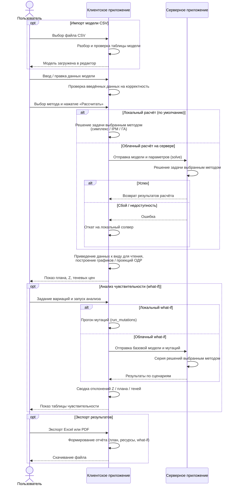
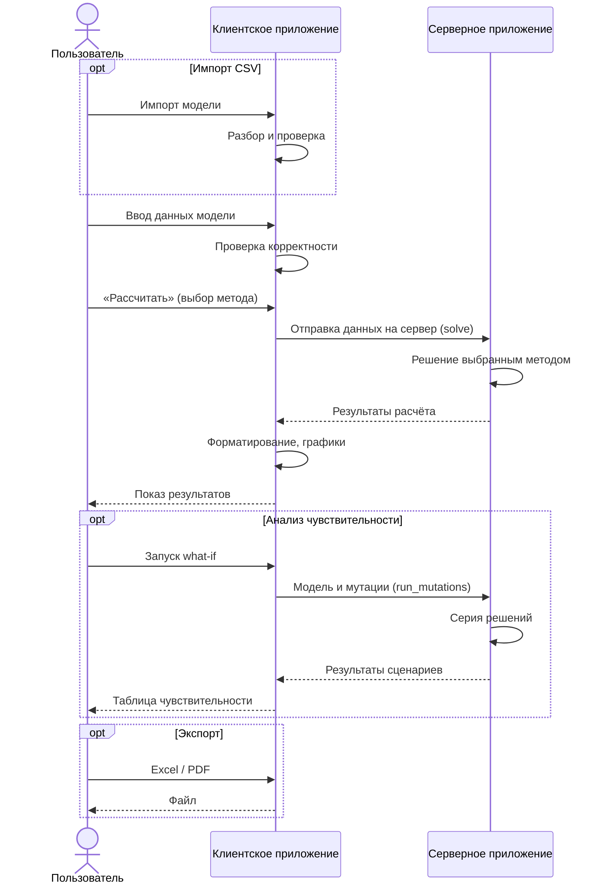

# UML — Sequence

Диаграмма последовательности для сценария **решения задачи оптимизации** с последующим анализом чувствительности, опциональными импортом/экспортом и альтернативой локального либо серверного расчёта.

Рисунок в пояснительной: **2.4**.

---

## Диаграмма

Стиль как в учебной схеме: актёр «Пользователь» → «Клиентское приложение» → «Серверное приложение».

### Компактный вариант (для рисунка 2.4)

Без веток сбоя и без локального солвера: расчёт и what-if только на сервере, ответы всегда успешны. Удобнее по высоте для пояснительной.

---

## Описание

### Назначение

Показать **во времени** синхронное взаимодействие пользователя, клиентского приложения и сервера: подготовка модели → расчёт → (опционально) анализ чувствительности → (опционально) выгрузка. Полная диаграмма выше учитывает локальный venue и откат; **компактный вариант** упрощает сценарий до успешного серверного расчёта (рекомендуется для рис. 2.4).

### Участники

| Участник                  | Смысл                                                                                |
| ------------------------- | ------------------------------------------------------------------------------------ |
| **Пользователь**          | Инициирует ввод, расчёт, what-if, импорт/экспорт.                                    |
| **Клиентское приложение** | UI: валидация, отображение, вызов сервера.                                           |
| **Серверное приложение**  | Edge `solve` / `run_mutations` (в компактном варианте — единственное место решения). |

### Ветвления (компактный вариант)

| Фрагмент         | Смысл                                                     |
| ---------------- | --------------------------------------------------------- |
| `opt` Импорт CSV | Необязательный старт с файла.                             |
| Серверный solve  | Клиент всегда отправляет задачу на сервер; ответ успешен. |
| `opt` What-if    | Серия мутаций на сервере после базового решения.          |
| `opt` Экспорт    | Excel / PDF по готовому результату.                       |

Метод (симплекс / IPM / ГА) выбирается на клиенте и передаётся серверу как параметр «решение выбранным методом».
