# UML — Use Case

Диаграмма вариантов использования приложения **«Планировщик распределения ресурсов»**.

---

## Диаграмма

Актёры снаружи границы системы. Внутри — два блока: сценарии **без входа** и сценарии, которые **включают** («include») авторизацию.

```mermaid
flowchart TB
  Guest((Гость))
  User((Пользователь))
  Mod((Модератор))
  Admin((Администратор))
  LinkViewer((Получатель ссылки))

  subgraph sys["Планировщик распределения ресурсов"]
    direction TB

    UC_auth(["Авторизация"])

    subgraph open["Без авторизации"]
      direction TB
      UC_guest(["Работа без входа"])
      UC_edit(["Редактировать модель задачи"])
      UC_solve(["Решить задачу оптимизации"])
      UC_lp(["Решение симплекс-методом"])
      UC_ipm(["Решение методом внутренней точки"])
      UC_ga(["Решение генетическим методом"])
      UC_exportLocal(["Экспорт результатов Excel / PDF"])
      UC_importLocal(["Импорт модели CSV"])
      UC_viewShare(["Просмотреть результат по ссылке"])
    end

    subgraph secured["Требуют авторизацию «include»"]
      direction TB
      UC_cloud(["Сохранить / открыть задачу в облаке"])
      UC_whatif(["Анализ чувствительности what-if"])
      UC_compare(["Сравнить задачи и методы"])
      UC_tpl(["Управлять личными шаблонами"])
      UC_pub(["Отправить шаблон в каталог"])
      UC_share(["Поделиться задачей / форкнуть"])
      UC_trash(["Восстановить или удалить из корзины"])
      UC_notify(["Просматривать уведомления"])
      UC_mod(["Модерировать публичные шаблоны"])
      UC_admin(["Управлять учётными записями"])
      UC_sysTpl(["Управлять системными шаблонами"])
      UC_cloudSolve(["Облачный расчёт Edge"])
    end

    UC_solve -.->|include| UC_lp
    UC_solve -.->|include| UC_ipm
    UC_solve -.->|include| UC_ga

    UC_cloud -.->|include| UC_auth
    UC_whatif -.->|include| UC_auth
    UC_compare -.->|include| UC_auth
    UC_tpl -.->|include| UC_auth
    UC_pub -.->|include| UC_auth
    UC_share -.->|include| UC_auth
    UC_trash -.->|include| UC_auth
    UC_notify -.->|include| UC_auth
    UC_mod -.->|include| UC_auth
    UC_admin -.->|include| UC_auth
    UC_sysTpl -.->|include| UC_auth
    UC_cloudSolve -.->|include| UC_auth
  end

  Guest --> UC_guest
  Guest --> UC_edit
  Guest --> UC_solve
  Guest --> UC_importLocal
  Guest --> UC_exportLocal
  Guest --> UC_auth

  User --> UC_auth
  User --> UC_edit
  User --> UC_solve
  User --> UC_importLocal
  User --> UC_exportLocal
  User --> UC_cloud
  User --> UC_whatif
  User --> UC_compare
  User --> UC_tpl
  User --> UC_pub
  User --> UC_share
  User --> UC_trash
  User --> UC_notify
  User --> UC_cloudSolve

  Mod --> UC_auth
  Mod --> UC_mod
  Mod --> UC_solve
  Mod --> UC_cloud

  Admin --> UC_auth
  Admin --> UC_admin
  Admin --> UC_sysTpl
  Admin --> UC_mod
  Admin --> UC_solve
  Admin --> UC_cloud

  LinkViewer --> UC_viewShare
```

Упрощённый вид для пояснительной:

```mermaid
flowchart TB
  Guest((Гость))
  User((Пользователь))
  Mod((Модератор))
  Admin((Администратор))
  LinkViewer((Получатель ссылки))

  subgraph sys["Планировщик распределения ресурсов"]
    UC_auth(["Авторизация"])

    subgraph open["Без авторизации"]
      UC_guest(["Работа без входа"])
      UC_edit(["Редактировать модель"])
      UC_solve(["Решить задачу оптимизации"])
      UC_io(["Импорт CSV / экспорт Excel·PDF"])
      UC_view(["Просмотр по ссылке"])
    end

    subgraph secured["Требуют авторизацию"]
      UC_cloud(["Облачные задачи"])
      UC_whatif(["Анализ what-if"])
      UC_tpl(["Шаблоны и каталог"])
      UC_share(["Поделиться / форкнуть"])
      UC_compare(["Сравнение"])
      UC_trash(["Корзина"])
      UC_notify(["Уведомления"])
      UC_mod(["Модерация каталога"])
      UC_admin(["Управление пользователями"])
      UC_edge(["Облачный расчёт"])
    end

    UC_cloud -.->|include| UC_auth
    UC_whatif -.->|include| UC_auth
    UC_tpl -.->|include| UC_auth
    UC_share -.->|include| UC_auth
    UC_compare -.->|include| UC_auth
    UC_trash -.->|include| UC_auth
    UC_notify -.->|include| UC_auth
    UC_mod -.->|include| UC_auth
    UC_admin -.->|include| UC_auth
    UC_edge -.->|include| UC_auth
  end

  Guest --- UC_guest
  Guest --- UC_edit
  Guest --- UC_solve
  Guest --- UC_io
  Guest --- UC_auth

  User --- UC_auth
  User --- UC_edit
  User --- UC_solve
  User --- UC_io
  User --- UC_cloud
  User --- UC_whatif
  User --- UC_tpl
  User --- UC_share
  User --- UC_compare
  User --- UC_trash
  User --- UC_notify
  User --- UC_edge

  Mod --- UC_mod
  Admin --- UC_admin
  Admin --- UC_mod
  LinkViewer --- UC_view
```

---

## Описание

### Назначение

Показать **функциональные требования** к системе: кто инициирует сценарии и какие цели достигаются, **без** деталей реализации (Edge, RLS, venue). Отдельно зафиксировано, какие сценарии доступны без входа, а какие **обязаны** включать авторизацию.

### Актёры

| Актёр                 | Роль в продукте                                                                        |
| --------------------- | -------------------------------------------------------------------------------------- |
| **Гость**             | Локальная модель без учётной записи; при входе сценарий может быть перенесён в облако. |
| **Пользователь**      | Роль `user`: облачные задачи, шаблоны, сравнение, шаринг, корзина, уведомления.        |
| **Модератор**         | Роль `mod`: очередь публикации публичных шаблонов.                                     |
| **Администратор**     | Роль `admin`: пользователи, системные шаблоны; также модерация каталога.               |
| **Получатель ссылки** | Просмотр результата по публичной share-ссылке **без** входа.                           |

Роли: `admin` \| `mod` \| `user` (`docs/data-model.md`). Организации в схеме есть, UI по умолчанию скрыт (`PUBLIC_SHOW_ORGS`) — на диаграмму не вынесены.

### Авторизация: что требуется, что нет

| Вариант использования                                     | Авторизация        | Пояснение                                                |
| --------------------------------------------------------- | ------------------ | -------------------------------------------------------- |
| Работа без входа                                          | Нет                | Гостевой слот на устройстве.                             |
| Редактировать модель                                      | Нет                | Доступно гостю и вошедшему пользователю.                 |
| Решить задачу оптимизации (локально)                      | Нет                | Солвер на клиенте; методы — include симплекс / IPM / ГА. |
| Импорт CSV / экспорт Excel·PDF                            | Нет                | Работа с текущей моделью/результатом на клиенте.         |
| Просмотреть результат по ссылке                           | Нет                | Публичный `/share/[token]`.                              |
| Авторизация                                               | —                  | Сам сценарий входа (регистрация в UI отключена).         |
| Сохранить / открыть задачу в облаке                       | **Да** (`include`) | Оболочка `/app`, персистентность сценариев.              |
| Анализ what-if                                            | **Да**             | Дочерние сценарии в облаке.                              |
| Сравнить задачи и методы                                  | **Да**             | Сохранённые сравнения / выбор облачных задач.            |
| Личные шаблоны / заявка в каталог                         | **Да**             |                                                          |
| Поделиться / форкнуть                                     | **Да**             | Создание ссылки и копии.                                 |
| Корзина / уведомления                                     | **Да**             |                                                          |
| Модерация / управление пользователями / системные шаблоны | **Да**             | Плюс роль `mod` / `admin`.                               |
| Облачный расчёт Edge                                      | **Да**             | JWT-сессия; иначе — только локальный solve.              |

Связь **include → Авторизация** на диаграмме означает: сценарий выполняется только при успешной аутентификации (для staff-сценариев — ещё и нужная роль).

### Связи include (методы)

«Решить задачу оптимизации» **включает** конкретный метод (симплекс, внутренняя точка, генетический) — учебная детализация способа решения, не связанная с входом в систему.
